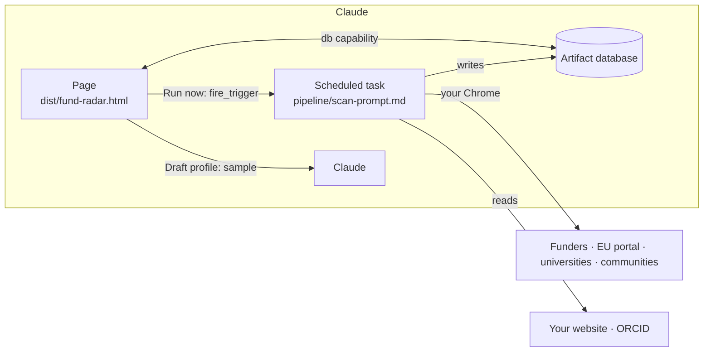

# Fund Radar

> **Claude only.** Fund Radar runs on Claude: the page is a Claude artifact and the weekly scan is a Claude scheduled task. It is a sibling of [Research Radar](https://github.com/alvarobernal2412/research-radar) and copies its build, runtime and installation approach.

A weekly radar of research funding calls, in one Claude artifact. You choose the countries and the kinds of funding you are looking for; a weekly Claude scan reads the funders' sites, checks every call against your profile, and ranks the calls by how well they fit you. You need no programming background: setup is one prompt, and everything else happens on the radar's pages.

- **Calls:** a catalogue of open calls with filters (type, country, eligibility, status, deadline window, minimum affinity) and search. Each call shows its eligibility verdict, its affinity score with the three parts behind it, the next deadline and whether it leaves you enough preparation time. Mark calls as **Interested** or **Applying**, or **Discard** them with a reason (unreachable, not interesting, not eligible in practice). Discarded calls are kept: tick *Show discarded* to see them again.
- **Call detail:** every eligibility condition the funder states, marked met, unclear (with what you need to find out) or not met; the affinity parts with your weights; one line on why the call ranks where it does and what your profile lacks for it; required documents, deadlines, amount, duration, links, and where the call was found.
- **Profile:** built from your website or portfolio, ORCID, CV and LinkedIn PDF export, plus a short questionnaire (ambitions, relocation, teaching languages, preferred grant size). Claude drafts it; you confirm it. Your full publication list is kept, and you can hide any entry from matching. Each week the scan re-reads your website and proposes changes, which you accept or reject.
- **Scope & scans:** countries (each with a list of its main universities, which you mark as home or target institutions), European programmes, opportunity types, research communities, the sources this gives, affinity weights, preparation times, Run now, the scan timeline and log, and data export.

## Your data stays yours

The repository is only a template. When you install it, your radar's calls, profile and marks are stored in your own artifact's database, and your deployment settings (artifact link, task id) in `config/site.json`, which git ignores. The scan writes only to the artifact; it never commits anything. The artifact is private to you until you share it, and sharing it also shares your profile.

## Install

Clone and configure everything with one prompt. Paste the prompt from [docs/setup-prompt.md](docs/setup-prompt.md) into Claude Code (the desktop app, with Claude in Chrome). The agent asks a few multiple-choice questions (folder, countries, kinds of funding, career stage, home institution, scan day), then clones the repository, builds the page, publishes the artifact, creates the weekly scan and tells you what is left: building your profile on the Profile page and pressing *Run now*.

Prefer to do it yourself?

```bash
git clone https://github.com/alvarobernal2412/fund-radar.git && cd fund-radar
cp config/site.example.json config/site.json   # then edit it
python -m pytest && python site/build.py --check
```

then follow the steps of the setup prompt by hand.

## Update

When the repository has new commits, paste the prompt from [docs/update-prompt.md](docs/update-prompt.md) into Claude Code from your clone. It pulls, tests, rebuilds, republishes the page in place (your data is kept) and updates the scheduled task only if the scan instructions or the source packs changed.

## Countries and sources

Sources come in packs under `packs/`:

- `packs/eu.json`: European programmes (EU Funding & Tenders portal, EURAXESS).
- `packs/countries/<code>.json`: one per country, with its national funders and its main universities. Switzerland is included (SNSF, Innosuisse, Euresearch, swissuniversities, and sixteen universities and universities of applied sciences).
- `packs/community.json`: announcement channels of research communities.

A university marked as your **home institution** is scanned for internal funds (seed money, networking and event grants, travel grants). A **target institution** is a place you might move to; it counts as a possible host when a call requires one. When a university's funding page is not in the pack, your first scan finds it and keeps it in your radar. To add a country, see [docs/new-pack.md](docs/new-pack.md).

## How it works



- The **page** is one HTML file published as a Claude artifact. It reads and writes the artifact's database. It can't reach the web itself.
- The **scan** is a Claude scheduled task on your computer. Its instructions are [pipeline/scan-prompt.md](pipeline/scan-prompt.md), with the source packs embedded. It reads the sources through your Chrome, de-duplicates calls (keeping the funder's own page as the main link), checks eligibility, scores fit, and writes the results.
- **Eligibility and affinity are kept apart.** A call you cannot apply for is marked *not eligible* whatever its fit; one with unclear conditions is marked *check*, with what to find out. Affinity = topical fit × weight + skills fit × weight + practical fit × weight (50 / 30 / 20 by default, yours to change). The deadline never changes the score.

More detail: [docs/architecture.md](docs/architecture.md). Data model: [pipeline/schema/fund.schema.json](pipeline/schema/fund.schema.json).

## Repository layout

```
site/
  src/index.html        page template ({{TITLE}}, {{STYLES}}, {{SCRIPTS}})
  src/styles/*.css      main.css first (copied from Research Radar), then alphabetical
  src/js/NN-*.js        concatenated in numeric order into one strict-mode scope
  build.py              assembles dist/fund-radar.html and embeds the packs (standard library only)
  static-shim.js        read-only runtime for an optional snapshot page (calls only, never the profile)
  vendor.json           pinned CDN libraries (pdf.js, loaded only to read PDFs)
  capabilities.json     runtime capabilities to declare when publishing
pipeline/
  scan-prompt.md        the weekly scan's instructions ({{ARTIFACT_URL}}, {{PACKS}})
  render_prompt.py      fills in the prompt from config/site.json and packs/
  fund/                 scoring, eligibility, de-duplication, packs and scheduling rules (tested)
  schema/               JSON Schema of every stored document and the export file
packs/                  eu.json, community.json, countries/<code>.json (+ _template.json)
config/
  site.example.json     template for your deployment settings; copy to site.json (git-ignored)
docs/                   setup and update prompts, architecture, adding a country
tests/
  test_pipeline.py      pytest for the pipeline helpers and the packs
  smoke/smoke.js        end-to-end test of the built page against a mocked runtime
  fixtures/             sample calls and profile (fictional)
LICENSE                 Apache-2.0
```

## Working on it

```bash
python -m pytest                        # pipeline and pack tests
python site/build.py --check            # build dist/fund-radar.html and syntax-check it
npm install && npm run smoke            # end-to-end test (set CHROMIUM=/path/to/chrome if needed)
```

**Changing the scan.** Edit `pipeline/scan-prompt.md` or a pack, run `python pipeline/render_prompt.py`, and ask Claude to update the scheduled task's prompt with the output. A task that runs on your computer must be approved from a conversation linked to that computer.

## Limits worth knowing

- Sources are read through Chrome on your computer, so it must be on with Chrome open during a scan. Sites that ask for a sign-in or show a bot check are skipped and listed as *not read*.
- LinkedIn does not allow automated reading of profiles; add its PDF export on the Profile page instead.
- Eligibility checks are only as good as the profile and the call text. A *check* verdict means: read the condition yourself. Always confirm the rules on the funder's page before applying.
- Academic positions (postdoc, lecturer, professor) are planned for a later version.

## License

Apache License 2.0. See [LICENSE](LICENSE).
