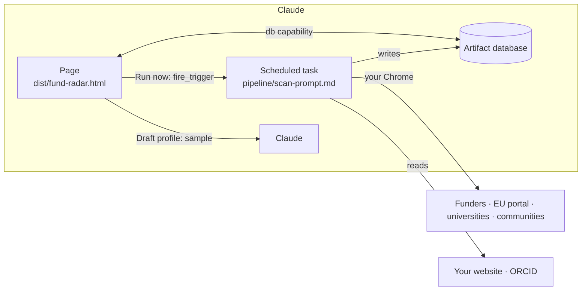

# Fund Radar

> **Claude only.** Fund Radar runs on Claude: the page is a Claude artifact and the weekly scan is a Claude scheduled task. It is a sibling of [Research Radar](https://github.com/alvarobernal2412/research-radar) and copies its build, runtime and installation approach.

A weekly radar of research funding calls, in one Claude artifact. You choose the countries and the kinds of funding you are looking for; a weekly Claude scan reads the funders' sites, checks every call against your profile, and ranks the calls by how well they fit you. You need no programming background: setup is one prompt, and everything else happens on the radar's pages.

- **Calls:** a catalogue of open calls with filters (type, country, eligibility, status, deadline window, minimum affinity) and search. Each call shows its eligibility verdict, its affinity score with the three parts behind it, the next deadline and whether it leaves you enough preparation time. Mark calls as **Interested** or **Applying**, or **Discard** them with a reason (unreachable, not interesting, not eligible in practice). Discarded calls are kept: tick *Show discarded* to see them again.
- **Call detail:** every eligibility condition the funder states, marked met, unclear (with what you need to find out) or not met; the affinity parts with your weights; one line on why the call ranks where it does and what your profile lacks for it; required documents, deadlines, amount, duration, links, and where the call was found.
- **Profile:** built from your website or portfolio, ORCID, CV and LinkedIn PDF export, plus a short questionnaire (ambitions, relocation, teaching languages, preferred grant size). Claude drafts it; you confirm it. Your full publication list is kept, and you can hide any entry from matching. Each week the scan re-reads your website and proposes changes, which you accept or reject.
- **Scope & scans:** countries (each with a list of its main universities, which you mark as home or target institutions), European programmes, opportunity types, research communities, the sources this gives, affinity weights, preparation times, Run now, the scan timeline and log, and data export.

## Your data stays yours

The repository is only a template. When you install it, your radar's calls, profile and marks are stored in your own artifact's database, and your deployment settings (artifact link, task id) in `config/site.json`, which git ignores. The scan writes only to the artifact; it never commits anything. The artifact is private to you until you share it, and sharing it also shares your profile.

## Install

Clone and configure everything with one prompt. Paste this into Claude Code (the desktop app, with Claude in Chrome, because the funders' sites are read through your browser). The agent first asks a few multiple-choice questions (folder, countries, kinds of funding, career stage, home institution, scan day), so there is nothing to fill in. It then clones the repository, builds the page, publishes the artifact, creates the weekly scan and tells you what is left: building your profile on the Profile page and pressing *Run now*.

```text
I want to set up Fund Radar, a weekly radar of research funding calls. Clone the
repo and configure everything, then tell me what is left for me to do by hand.

Repo: https://github.com/alvarobernal2412/fund-radar

Before you do anything else, clone the repo into a temporary folder and read
README.md, docs/new-pack.md and the packs under packs/, so you can offer the
countries and universities that have a source pack. Then ask me for the values
below. Use the AskUserQuestion tool (multiple-choice with an "Other" free-text
option) in two calls, because it takes at most 4 questions each. If that tool
is not available, ask the same questions in plain text in one message. Mark the
suggested option "(Recommended)" and wait for my answers.

Call 1:
1. Clone folder: ~/code/fund-radar (Recommended) / the current directory / Other.
2. Countries to scan (multiple choice): one option per country pack in
   packs/countries/ (skip files starting with _), plus "EU and international
   programmes" (Recommended, ticked by default). Under Other I can type ISO
   codes of countries without a pack.
3. Opportunity types (multiple choice): Project funding (project) /
   Fellowships and mobility (fellowship, mobility) / Networking and event
   funds (networking) / Prizes (prize). Nothing ticked means all.
4. Career stage: PhD student (phd) / Postdoc (postdoc) / Senior researcher or
   lecturer (senior) / Professor (professor). Anything under Other is "other".

Call 2:
5. My home institution, whose internal funds should be scanned: offer up to
   three universities from the pack of the first country I picked, and let me
   type another under Other. "None" is a valid answer.
6. Scan day: call assign_slot() from pipeline/fund/schedule.py with the
   weekday and time of every Research Radar scan you find on this computer
   (research-radar clones list them in config/site.json under radars; a
   config without radars is one radar, whose slot is in its scheduleText), so
   the two never scan on the same day. Offer the slot it returns, moved to a
   minute that is not on the hour (e.g. 09:00 becomes 09:49), as the
   Recommended option / another free weekday / Other. Ask my time zone if you
   cannot read it from this machine.
7. Radar name: "Fund Radar" (Recommended) / Other.

Steps:
1. Move or clone the repo into the folder I gave you. Check python 3.11+ is
   installed (node is optional). Install nothing system-wide without asking me.
   Run: python -m pytest
2. Copy config/site.example.json to config/site.json and fill in title,
   siteName, scheduleText, weekday, time and timezone from my answers.
   config/site.json is git-ignored: never commit it.
3. Build: python site/build.py --check
4. Publish dist/fund-radar.html as a NEW artifact with the capabilities in
   site/capabilities.json. Put the returned URL into config/site.json as
   artifactUrl, and git rev-parse HEAD as lastPublishedCommit. If
   config/site.json already has a real artifactUrl (this is a re-run), read
   that artifact first and update it in place instead of creating a second one.
5. Run python pipeline/render_prompt.py and create a scheduled task named
   "<radar name> weekly scan" at my slot (cron_expression() in
   pipeline/fund/schedule.py gives the cron line), using that output as its
   prompt. It must run on my computer (Chrome reads the funders' sites). Put
   the task id into config/site.json as triggerId.
6. Write to the artifact's database:
   - meta/config: {siteName, scheduleText, timezone, triggerId,
     countries (upper-case ISO codes), includeEU, opportunityTypes (project,
     fellowship, mobility, networking, prize; empty for all), careerStage
     (phd, postdoc, senior, professor), institutions ([{id, country, role:
     "home"}] for my home institution, using the pack's institution id),
     communities: [], prepWeeks: {}}
   - meta/weights: {topical: 0.5, skills: 0.3, practical: 0.2}
   - meta/profile: {revision: 0, confirmedAt: null, inputs: {}}
   Nothing from my scope or profile goes into the repository.
7. Finish with a short checklist of what I still have to do myself. It must
   include: open the radar's Profile page, add my website, ORCID, CV and
   LinkedIn PDF export, answer the questionnaire, draft and confirm the
   profile; check the scope and pick target institutions on Scope & scans;
   then press "Run now" for the first scan (the radar is empty until a scan
   has run). Note that the artifact is private until I share it from its
   Share menu, and that sharing it also shares my profile.

Rules:
- Never commit config/site.json, data exports, or anything from my profile.
- Do not ask me to paste my CV or LinkedIn export into the chat: they go on the
  radar's Profile page.
- Do not run git commit yourself: show me the proposed message and wait.
```

Prefer to do it yourself?

```bash
git clone https://github.com/alvarobernal2412/fund-radar.git && cd fund-radar
cp config/site.example.json config/site.json   # then edit it
python -m pytest && python site/build.py --check
```

then follow the steps of the prompt by hand. What the prompt cannot do for you (your profile, the first scan, task approval) is listed in [docs/setup-prompt.md](docs/setup-prompt.md).

## Update

When the repository has new commits, bring your radar up to date with one prompt. Paste this into Claude Code from your clone. It pulls, tests, rebuilds, republishes the page in place (your data is kept) and updates the scheduled task only if the scan instructions or the source packs changed:

```text
Update my Fund Radar to the latest code in the repo. Do not change my data.

Before you do anything else, ask me with the AskUserQuestion tool (or in plain
text if it is not available):
1. Which folder holds my clone: the current directory (Recommended) / Other.
2. If the scan instructions or the packs changed, should you update my
   scheduled task automatically (Recommended), show me the diff first, or
   leave the task alone?

Steps:
1. Go to the clone. Run git status. If there are uncommitted changes, stop and
   show them to me. Check that config/site.json exists and has an artifactUrl;
   if not, this clone was never installed: point me to the install prompt in
   README.md and stop.
2. git fetch, then git pull --ff-only. Never merge, rebase or force anything
   without asking me. Let OLD be config/site.json's lastPublishedCommit (or, if
   it is missing, the commit I was on before pulling) and NEW be HEAD. If OLD
   and NEW are the same, tell me everything is up to date and stop.
3. Summarise git log --oneline OLD..NEW and git diff --stat OLD..NEW in plain
   language, grouped as: page (site/), scan instructions
   (pipeline/scan-prompt.md, pipeline/render_prompt.py), source packs
   (packs/), data model (pipeline/schema/), capabilities
   (site/capabilities.json), docs and tests.
4. Run python -m pytest and python site/build.py --check. Stop and show me the
   output if either fails.
5. Publish the page in place: read the live artifact at artifactUrl first, then
   publish dist/fund-radar.html to that same URL. Pass capabilities only if
   site/capabilities.json changed between OLD and NEW.
6. If pipeline/scan-prompt.md, pipeline/render_prompt.py or anything under
   packs/ changed: run python pipeline/render_prompt.py, compare it with my
   scheduled task's current prompt, and update the task according to my answer
   to question 2. Keep its schedule and task id.
7. If pipeline/schema/ changed, tell me what changed and whether stored
   documents need a migration. Do not write to the database unless a commit
   message or the docs say a migration is required, and then ask me first.
8. Verify: run the smoke test (npm install && npm run smoke) if node and a
   browser are available, otherwise open the artifact and check that it loads
   without errors. Report anything that failed.
9. Write NEW into config/site.json as lastPublishedCommit and report what was
   updated and what I still have to do myself.

Rules:
- Never commit, force-push or delete data. Never commit config/site.json or any
  export.
- If a step fails, stop and tell me; do not work around it silently.
```

More detail: [docs/update-prompt.md](docs/update-prompt.md).

## Countries and sources

Sources come in packs under `packs/`:

- `packs/eu.json`: European programmes (EU Funding & Tenders portal, EURAXESS).
- `packs/countries/<code>.json`: one per country, with its national funders and its main universities. Switzerland is included (SNSF, Innosuisse, Euresearch, swissuniversities, and sixteen universities and universities of applied sciences).
- `packs/community.json`: announcement channels of research communities.

A university marked as your **home institution** is scanned for internal funds (seed money, networking and event grants, travel grants). A **target institution** is a place you might move to; it counts as a possible host when a call requires one. When a university's funding page is not in the pack, your first scan finds it and keeps it in your radar. To add a country, see [docs/new-pack.md](docs/new-pack.md).

## How it works



- The **page** is one HTML file published as a Claude artifact. It reads and writes the artifact's database. It can't reach the web itself.
- The **scan** is a Claude scheduled task on your computer. Its instructions are [pipeline/scan-prompt.md](pipeline/scan-prompt.md), with the source packs embedded. It reads the sources through your Chrome, de-duplicates calls (keeping the funder's own page as the main link), checks eligibility, scores fit, and writes the results.
- **Eligibility and affinity are kept apart.** A call you cannot apply for is marked *not eligible* whatever its fit; one with unclear conditions is marked *check*, with what to find out. Affinity = topical fit × weight + skills fit × weight + practical fit × weight (50 / 30 / 20 by default, yours to change). The deadline never changes the score.

More detail: [docs/architecture.md](docs/architecture.md). Data model: [pipeline/schema/fund.schema.json](pipeline/schema/fund.schema.json).

## Repository layout

```
site/
  src/index.html        page template ({{TITLE}}, {{STYLES}}, {{SCRIPTS}})
  src/styles/*.css      main.css first (copied from Research Radar), then alphabetical
  src/js/NN-*.js        concatenated in numeric order into one strict-mode scope
  build.py              assembles dist/fund-radar.html and embeds the packs (standard library only)
  static-shim.js        read-only runtime for an optional snapshot page (calls only, never the profile)
  vendor.json           pinned CDN libraries (pdf.js, loaded only to read PDFs)
  capabilities.json     runtime capabilities to declare when publishing
pipeline/
  scan-prompt.md        the weekly scan's instructions ({{ARTIFACT_URL}}, {{PACKS}})
  render_prompt.py      fills in the prompt from config/site.json and packs/
  fund/                 scoring, eligibility, de-duplication, packs and scheduling rules (tested)
  schema/               JSON Schema of every stored document and the export file
packs/                  eu.json, community.json, countries/<code>.json (+ _template.json)
config/
  site.example.json     template for your deployment settings; copy to site.json (git-ignored)
docs/                   setup and update prompts, architecture, adding a country
tests/
  test_pipeline.py      pytest for the pipeline helpers and the packs
  smoke/smoke.js        end-to-end test of the built page against a mocked runtime
  fixtures/             sample calls and profile (fictional)
LICENSE                 Apache-2.0
```

## Working on it

```bash
python -m pytest                        # pipeline and pack tests
python site/build.py --check            # build dist/fund-radar.html and syntax-check it
npm install && npm run smoke            # end-to-end test (set CHROMIUM=/path/to/chrome if needed)
```

**Changing the scan.** Edit `pipeline/scan-prompt.md` or a pack, run `python pipeline/render_prompt.py`, and ask Claude to update the scheduled task's prompt with the output. A task that runs on your computer must be approved from a conversation linked to that computer.

## Limits worth knowing

- Sources are read through Chrome on your computer, so it must be on with Chrome open during a scan. Sites that ask for a sign-in or show a bot check are skipped and listed as *not read*.
- LinkedIn does not allow automated reading of profiles; add its PDF export on the Profile page instead.
- Eligibility checks are only as good as the profile and the call text. A *check* verdict means: read the condition yourself. Always confirm the rules on the funder's page before applying.
- Academic positions (postdoc, lecturer, professor) are planned for a later version.

## License

Apache License 2.0. See [LICENSE](LICENSE).
